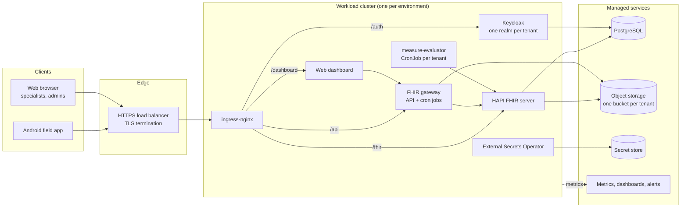

# Managed-cloud deployment (multi-tenant)

[](../LICENSE)

Infrastructure as code and GitOps configuration for **Aarogya Aarohan**, a multi-tenant oral-cancer screening platform built on HL7 FHIR R4.

This folder is the single source of truth for everything the platform runs on. It contains:

- **Terraform** that builds the cloud resources: network attachments, Kubernetes clusters, a managed PostgreSQL database per environment, object storage buckets per tenant, secret storage, IAM and monitoring.
- **ArgoCD Applications, Kustomize overlays and Helm values** that deploy the application stack onto those clusters: HAPI FHIR server, Keycloak, the FHIR gateway (backend), the web dashboard, scheduled metric jobs and cluster add-ons.
- **Scripts** for the steps neither tool can do on its own: creating a tenant's identity realm and FHIR partition, and migrating data between deployments.

The reference deployment runs on Google Cloud (GKE, Cloud SQL, Cloud Storage, Secret Manager). Every cloud-specific piece is isolated behind a small number of modules and overlays, and [docs/cloud-portability.md](docs/cloud-portability.md) explains how to run the same stack on AWS, Azure or any conformant Kubernetes cluster.

> **Clinical disclaimer.** Aarogya Aarohan is an **assisted screening tool**. It helps health workers capture screening data and routes cases to qualified specialists for review. It is **not an autonomous diagnostic device**, and any AI output it displays is decision support for a clinician, not a diagnosis. See [docs/data-protection.md](docs/data-protection.md).

---

## Contents

| Document | What it covers |
|---|---|
| [docs/architecture.md](docs/architecture.md) | System architecture, request flow, multi-tenancy model, secrets and identity chains (Mermaid diagrams) |
| [docs/deployment-guide.md](docs/deployment-guide.md) | Standing up the full platform from an empty cloud account |
| [docs/cloud-portability.md](docs/cloud-portability.md) | Mapping every GCP service to AWS, Azure and self-hosted equivalents, and what to change in this repo |
| [docs/local-development.md](docs/local-development.md) | Running the stack on a laptop with a local Kubernetes cluster, no cloud account needed |
| [docs/tenant-onboarding.md](docs/tenant-onboarding.md) | Adding a new tenant (a state or hospital programme) |
| [docs/operations.md](docs/operations.md) | Releases, rollback, backups, secret rotation, monitoring, troubleshooting |
| [docs/data-protection.md](docs/data-protection.md) | How patient data is stored, isolated, encrypted and handled; clinical boundaries |
| [CONTRIBUTING.md](../CONTRIBUTING.md) | How to propose changes |
| [SECURITY.md](../SECURITY.md) | How to report a vulnerability |
| [CODE_OF_CONDUCT.md](../CODE_OF_CONDUCT.md) | Community expectations |

---

## Where this repo sits in the full stack

| Repository | What it is | How it reaches production |
|---|---|---|
| **managed-cloud/** (this folder) | Terraform + GitOps configuration | Terraform is applied by an operator; ArgoCD continuously syncs the Kubernetes config |
| arogyam-backend | NestJS FHIR gateway: tenant-aware API, background jobs, measure evaluator | Container images, pinned by tag in `components/fhir-gateway` and `components/measure-evaluator` |
| arogyam-dashboard | Next.js web dashboard for specialists and programme admins | Container image, pinned in `components/arogyam-dashboard` |
| fhir-server | HAPI FHIR 7.x fork with tenant partitioning and object-storage binary support | Container image, pinned in `components/hapi-fhir` |
| fhir-app | Android field app (OpenSRP FHIR Core based), offline-first | Distributed as an APK; talks to the platform over HTTPS |



---

## Quick start

There are two ways to run this repo.

### Option A: local evaluation (no cloud account)

Follow [docs/local-development.md](docs/local-development.md). You will create a local Kubernetes cluster with `kind`, install ArgoCD, point it at your fork of this repo and deploy the `local` overlays, which replace the managed database, object storage and secret store with in-cluster PostgreSQL, MinIO and plain Kubernetes Secrets.

### Option B: full cloud deployment

Follow [docs/deployment-guide.md](docs/deployment-guide.md). The short version, for the GCP reference implementation:

```bash
# 0. Prerequisites: terraform >= 1.5, kubectl, helm, kustomize, sops, age, gcloud, jq, make

# 1. Fork and clone
git clone https://github.com/<your-org>/aarogya-aarohan-dpg-infra.git && cd aarogya-aarohan-dpg-infra/managed-cloud

# 2. Create your encrypted variables (see terraform/secrets.example.json)
age-keygen -o ~/.config/sops/age/keys.txt          # note the public key
#    put your public key in .sops.yaml, then for each stack:
cp terraform/secrets.example.json terraform/envs/staging/secrets.enc.json
sops --encrypt --in-place terraform/envs/staging/secrets.enc.json

# 3. Apply the stacks in order
make apply ENV=_bootstrap        # remote state bucket
make plan  ENV=network    && make apply ENV=network
#    argocd stack, cluster module only (see deployment guide step 3)
make plan  ENV=staging    && make apply ENV=staging
#    seed the ArgoCD deploy key in the secret store (DB passwords are generated by Terraform)
make plan  ENV=argocd     && make apply ENV=argocd   # from the bastion: installs ArgoCD + root apps
scripts/seed-fhir-bundle.sh --env staging            # shared reference data in the DEFAULT partition
make plan  ENV=monitoring && make apply ENV=monitoring

# 4. ArgoCD now syncs apps/ and components/ from your fork automatically
```

Every value that identifies a specific deployment (project ID, region, domain, CIDRs, tenant list) is a variable. Nothing in the repo needs to be hand-edited to deploy into your own account apart from the files listed in [docs/deployment-guide.md § Values you must set](docs/deployment-guide.md#values-you-must-set).

### Prerequisites

| Tool | Version | Used for |
|---|---|---|
| Terraform | 1.5 or later (see `versions.tf` in each stack) | Cloud resources |
| kubectl | within one minor version of your cluster | Cluster access |
| Helm | 3.x | Rendering third-party charts |
| Kustomize | 5.x (or `kubectl kustomize`) | Rendering in-house manifests |
| SOPS + age | SOPS 3.8+, age 1.1+ | Encrypting Terraform variables |
| jq, curl, bash | any recent | Onboarding and migration scripts |
| Cloud CLI | `gcloud` (reference), or `aws` / `az` | Authentication to your cloud |

---

## Repository layout

```
managed-cloud/
├── terraform/                  Cloud resources (applied by an operator)
│   ├── modules/                Reusable building blocks
│   │   ├── network/            Creates or looks up the VPC, subnet, ranges, NAT, firewall
│   │   ├── gke-cluster/        Private Kubernetes cluster + autoscaling node pool
│   │   ├── cloud-sql/          Managed PostgreSQL 16, private IP, backups, PITR
│   │   ├── tenant-gcs/         One tenant's media bucket + access bindings
│   │   ├── tenant-secrets/     One tenant's secret entries + access bindings
│   │   ├── argocd/             Installs ArgoCD, registers clusters, seeds root apps
│   │   ├── argocd-spoke-cred/  Deploy credential ArgoCD uses for each workload cluster
│   │   └── workload-identity-impersonation/
│   └── envs/                   One Terraform root ("stack") per area, each with its own state
│       ├── _bootstrap/         The remote-state bucket
│       ├── network/
│       ├── argocd/             Hub cluster + ArgoCD
│       ├── staging/
│       ├── production/
│       └── monitoring/         Dashboards, alert policies, uptime checks
├── apps/                       ArgoCD Applications (app-of-apps entry point)
│   ├── app_of_apps/root.yaml
│   ├── app_of_projects/root.yaml
│   ├── platform/               Cluster add-ons: ingress-nginx, External Secrets, metrics
│   └── arogyam/                Product services, one file per service per environment
├── projects/                   ArgoCD AppProjects (permission boundaries per environment)
├── components/                 What gets deployed
│   ├── hapi-fhir/              Kustomize: base/ + overlays/{staging,production}
│   ├── fhir-gateway/           Kustomize
│   ├── arogyam-dashboard/      Kustomize
│   ├── measure-evaluator/      Kustomize (+ generated per-tenant CronJobs)
│   ├── external-secrets/       Kustomize: ClusterSecretStore + ExternalSecrets
│   ├── gmp/                    Metrics scrape config
│   ├── keycloak/               Helm values (base + per environment)
│   └── ingress-nginx/          Helm values
├── scripts/                    Tenant onboarding, migration, generators
├── docs/                       This documentation
├── Makefile                    Safe Terraform wrapper (decrypt → plan → apply saved plan)
├── .sops.yaml                  Who can decrypt the encrypted variable files
└── .pre-commit-config.yaml     Blocks committing decrypted secrets
```

The design rule is simple: **Terraform owns everything outside Kubernetes, ArgoCD owns everything inside it.** Terraform's last step is to install ArgoCD and hand it two root Applications. From then on, a change merged to the tracked branch is applied to the clusters automatically.

---

## Configuration

| File | Purpose | Committed? |
|---|---|---|
| `terraform/envs/<stack>/secrets.enc.json` | Deployment-specific Terraform variables (project, region, CIDRs, authorised networks, tenant list). SOPS-encrypted. | Yes, encrypted only |
| [`terraform/secrets.example.json`](terraform/secrets.example.json) | Template for the file above with dummy values | Yes |
| [`scripts/.env.example`](scripts/.env.example) | Environment variables the onboarding and migration scripts read | Yes; export the values in your shell |
| `components/*/overlays/<env>/kustomization.yaml` | Image tags, replica counts, hostnames per environment | Yes |
| Secret store entries | Database passwords, Keycloak admin, per-tenant client secrets, Git deploy key | **Never** in Git; referenced by name only |

---

## License

Licensed under the [Apache License 2.0](../LICENSE).

Aarogya Aarohan builds on open-source projects including [HAPI FHIR](https://hapifhir.io/) (Apache 2.0), [Keycloak](https://www.keycloak.org/) (Apache 2.0), [ArgoCD](https://argo-cd.readthedocs.io/) (Apache 2.0), [External Secrets Operator](https://external-secrets.io/) (Apache 2.0), [ingress-nginx](https://kubernetes.github.io/ingress-nginx/) (Apache 2.0) and [OpenSRP FHIR Core](https://github.com/opensrp/fhircore) (Apache 2.0).
