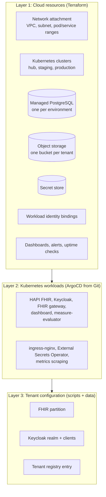
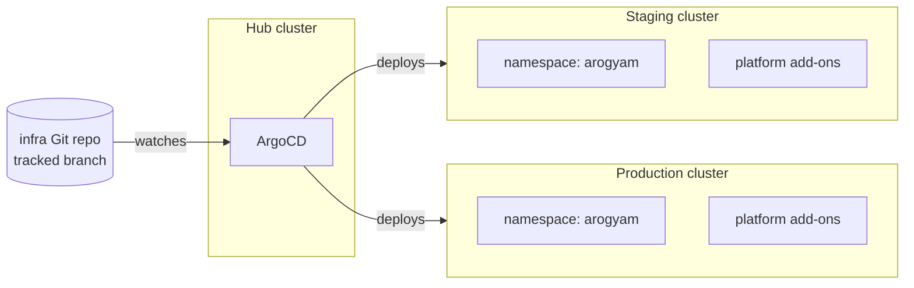
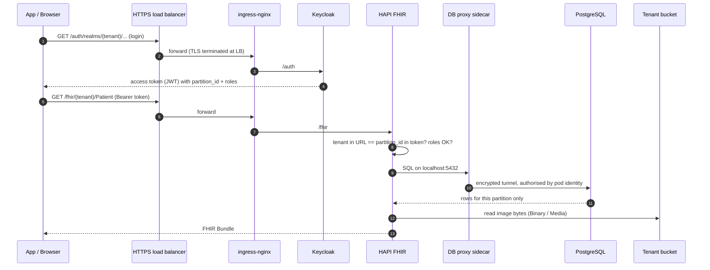
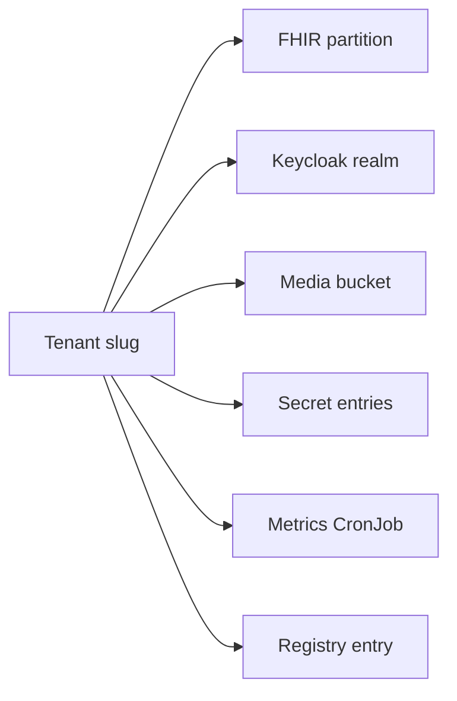
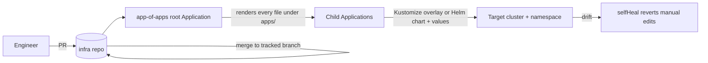
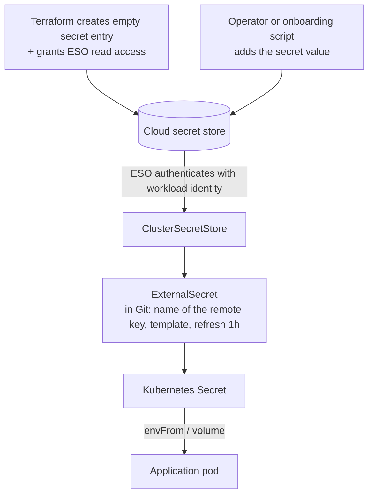
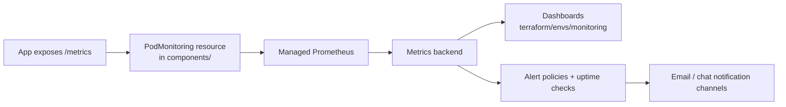

# Architecture

This document describes how Aarogya Aarohan is deployed: the layers, how a request flows through them, how tenants are isolated, and how secrets, identity, deployment and monitoring are wired together. Diagrams are Mermaid and render directly on GitHub.

The reference implementation runs on Google Cloud. Cloud-specific names appear in brackets the first time they are used, e.g. "managed PostgreSQL [Cloud SQL]". For the equivalent on other clouds see [cloud-portability.md](cloud-portability.md).

---

## 1. The product in one paragraph

A **health worker** uses an offline-first **Android app** to register a person, record an oral screening questionnaire and capture photographs of the oral cavity. The app syncs this data to a **FHIR R4 server** when connectivity allows. Cases flagged for review (by screening rules and, where enabled, an AI-assisted risk indicator) become **review tasks**, which a **specialist** completes remotely in a **web dashboard**. Programme administrators see aggregated indicators per site. Each state or hospital programme is a **tenant**.

The platform is an **assisted screening tool**; final clinical judgement always rests with a qualified clinician.

---

## 2. Three layers

| Layer | Owned by | Changes when |
|---|---|---|
| 1. Cloud resources | Terraform stacks in `terraform/envs/` | Infrastructure changes, or a tenant is added (bucket and secrets) |
| 2. Kubernetes workloads | ArgoCD, reading `apps/` and `components/` | A new image version, config change or replica change is merged |
| 3. Tenant configuration | `scripts/onboard-tenant-runtime.sh` plus the tenant registry | A tenant is onboarded or migrated |

---

## 3. Clusters and environments

| Cluster | Purpose | Notes |
|---|---|---|
| Hub | Runs only ArgoCD | No application traffic. If it is down, running apps are unaffected; only deployments and drift correction pause. |
| Staging | Pre-production workloads | Same manifests as production, smaller sizing |
| Production | Live workloads | More replicas, HA database |

All clusters are **private**: nodes have no public IPs and the Kubernetes API has no public endpoint. Operators reach the API through a bastion host reached over an identity-aware tunnel [IAP]. Outbound internet access from pods goes through a NAT gateway [Cloud NAT].

Clusters use VPC-native networking (pods and services get addresses from secondary ranges of the subnet), an eBPF dataplane that also enforces Kubernetes `NetworkPolicy` [GKE Dataplane V2], shielded nodes, workload identity, and one autoscaling node pool.

---

## 4. Request flow

Routing is by path on a single hostname per environment:

| Path | Service |
|---|---|
| `/fhir/{tenant}/...` | HAPI FHIR server |
| `/api/...` | FHIR gateway (backend API) |
| `/dashboard` | Web dashboard |
| `/auth/...` | Keycloak |

The load balancer sends traffic directly to ingress-nginx pod IPs using a network endpoint group [NEG], created from an annotation in the ingress-nginx Helm values. TLS is terminated at the load balancer with a wildcard certificate.

---

## 5. Applications

| Component | Role | Packaging | Notes |
|---|---|---|---|
| HAPI FHIR server | Stores all clinical data as FHIR R4 resources; enforces tenant partitions; stores binary content (images) in object storage | Kustomize (`components/hapi-fhir`) | Java; a fork of HAPI FHIR 7.x with a partition interceptor and object-storage binary support. Runs a DB proxy sidecar. |
| FHIR gateway | Tenant-aware backend API for the dashboard; background jobs (e.g. creating specialist review tasks, processing results) | Kustomize (`components/fhir-gateway`) | NestJS. Two Deployments: `web`, and `cron` with a single replica so each job runs once. |
| Web dashboard | UI for specialists and programme admins | Kustomize (`components/arogyam-dashboard`) | Next.js, OpenID Connect login against Keycloak |
| Keycloak | Authentication and token issuance; one realm per tenant | Helm (Bitnami chart) with values from `components/keycloak` | External PostgreSQL via DB proxy sidecar, served under `/auth` |
| measure-evaluator | Daily job computing programme indicators per tenant (FHIR `Measure` evaluation), written back to FHIR | Kustomize CronJobs, one per tenant, generated by `scripts/gen-evaluator-cronjobs.sh` | |
| ingress-nginx | Path routing inside the cluster | Helm, values in `components/ingress-nginx` | 2 replicas with anti-affinity, JSON access logs, metrics |
| External Secrets Operator | Copies values from the cloud secret store into Kubernetes Secrets | Helm, inline values | Installed first (sync wave −2) |

**Rule of thumb used throughout the repo:** Helm for third-party software (we set values, the chart maintainers own the manifests); Kustomize for manifests we own (one `base/` plus a small `overlays/<env>/` per environment).

---

## 6. Multi-tenancy

A tenant is a short slug such as `state-a`. That slug is the key everywhere:

| Piece | Example for tenant `state-a` |
|---|---|
| FHIR URL | `/fhir/state-a/...` (HAPI `URL_BASED` tenant identification) |
| FHIR partition | partition `state-a`; every resource row carries its partition id |
| Keycloak realm | realm `state-a`, with its own users, roles and clients |
| Object storage | bucket `<prefix>-state-a-fhir-media` |
| Secrets | per-tenant entries in the secret store (client secrets) |
| Metrics | its own measure-evaluator CronJob |
| Runtime registry | an entry in the tenant registry JSON read by the gateway, dashboard and Android app |

**Isolation is enforced in layers:**

1. **Identity:** each tenant's users live in a separate realm.
2. **Token claim:** login clients carry a `partition_id` claim mapper; HAPI rejects a request whose URL tenant does not match the token's claim (HTTP 403).
3. **Data:** HAPI scopes every query to the request's partition.
4. **Storage:** each tenant has its own bucket with its own access bindings.

Shared reference data (code systems, value sets, location hierarchy, CQL libraries used by measures) lives in a `DEFAULT` partition that every tenant can read.

Database-level row security (PostgreSQL RLS) as an additional layer has been designed but is **not implemented**; today isolation is enforced by the application tier.

**Why not one database or cluster per tenant?** The predecessor deployment ran a full stack per site (see the [`self-hosted/`](../self-hosted/) folder of this repository). That made onboarding an infrastructure project and multiplied every upgrade. Shared clusters with per-tenant partitions make a new tenant a configuration change.

---

## 7. GitOps: how changes reach the clusters

- **App-of-apps.** `apps/app_of_apps/root.yaml` is one Application that renders every YAML file under `apps/` recursively; each of those is itself an Application. Adding a file deploys a service; deleting it removes the service (`prune: true`). `apps/app_of_projects/root.yaml` does the same for `projects/`.
- **AppProjects** (`platform`, `aa-stg`, `aa-prod`) restrict each group of Applications to specific source repositories, one destination cluster and named namespaces, and allow only `Namespace` at cluster scope.
- **Three shapes of Application** are used:
  1. A Kustomize overlay path in this repo (in-house services).
  2. A pinned Helm chart from a public registry plus values files from this repo, using ArgoCD multi-source with `ref: values` (Keycloak, ingress-nginx).
  3. A pinned Helm chart with inline values (External Secrets Operator).
- **Sync policy:** automated with `prune` and `selfHeal`, `CreateNamespace=true`, `ServerSideApply=true`. Sync waves order operators before the resources that need them.
- **Releases** are a one-line change to `images[].newTag` in `components/<app>/overlays/<env>/kustomization.yaml`. **Rollback** is reverting that commit.

---

## 8. Secrets

- Git contains only **names** of secrets, never values.
- Terraform input variables that identify the deployment (project, CIDRs, tenant list) are kept in `secrets.enc.json` files encrypted with **SOPS**. The `Makefile` decrypts them to a temporary file only for the duration of a `plan`, and `apply` only applies a saved, reviewed plan. A pre-commit hook blocks committing a decrypted file.
- ExternalSecrets refresh hourly. Consumers that read secrets only at start-up (database credentials, the gateway's tenant credential bundle) need a restart after rotation; see [operations.md](operations.md#rotating-a-secret).

---

## 9. Workload identity (no key files)

Pods call cloud APIs with short-lived credentials bound to their Kubernetes ServiceAccount. No service-account key files exist anywhere in the platform.

| Kubernetes ServiceAccount | Cloud permission | Used for |
|---|---|---|
| `external-secrets/external-secrets` | Read access on each secret entry | Syncing secrets |
| `arogyam/hapi-fhir` | Read/write on tenant media buckets; DB proxy identity | Image storage; database connection |
| `arogyam/fhir-gateway` | Read on tenant media buckets | Serving images |
| `arogyam/keycloak` | DB proxy identity | Database connection |

Two styles are used on GCP: permissions granted **directly to the Kubernetes ServiceAccount principal** (storage, secrets), and **impersonation of a cloud service account** (only for the database proxy sidecar). On AWS the equivalent is IRSA or EKS Pod Identity; on Azure, Microsoft Entra Workload ID.

The database proxy handles network access and encryption; the application still logs in with a database username and password delivered from the secret store.

---

## 10. Data stores

| Store | Holds | Configuration (reference deployment) |
|---|---|---|
| PostgreSQL 16, one instance per environment | HAPI FHIR database (all tenants, partitioned) and Keycloak database | Private IP only, TLS required, automated daily backups, point-in-time recovery (7 days of logs); production runs with a synchronous standby (HA) and deletion protection |
| Object storage, one bucket per tenant per environment | FHIR binary content (screening photographs) | Uniform bucket-level access, object versioning with lifecycle cleanup of non-current versions after 90 days, CORS for the dashboard origin |
| Tenant registry (a JSON object in object storage) | List of tenants and their endpoints, read by the gateway, dashboard and Android app | |
| Terraform state bucket | Terraform state for every stack, with locking | Created by `terraform/envs/_bootstrap` |

All data is encrypted at rest by the cloud provider. See [data-protection.md](data-protection.md).

---

## 11. Observability

- **Collection:** Prometheus-format metrics from HAPI (JVM, HTTP), Keycloak, the FHIR gateway, ingress-nginx and the measure-evaluator, scraped by a managed Prometheus service [Google Managed Prometheus] configured through `PodMonitoring` resources in Git.
- **Dashboards and alerts are code:** `terraform/envs/monitoring` defines dashboards (JSON), alert policies (ingress 5xx ratio, p95 latency, restart storms, deployments with no ready replicas, database disk/CPU/availability, node pressure, metrics collection stopped) once per environment, uptime checks and notification channels.
- **Logs:** container stdout/stderr to the cloud logging service; ingress-nginx logs in JSON.

On a non-GCP cluster the same `/metrics` endpoints work with kube-prometheus-stack (Prometheus Operator `PodMonitor`/`ServiceMonitor`) and Grafana.

---

## 12. Failure behaviour

| Failure | Effect |
|---|---|
| A pod crashes | Kubernetes restarts it; other replicas keep serving |
| A node fails | Pods reschedule on remaining nodes |
| Primary database zone fails (production) | Managed failover to the standby |
| ArgoCD hub down | Apps keep running; deploys and drift correction pause |
| Secret store unreachable | Existing Kubernetes Secrets keep working |
| Keycloak down | No new logins; issued tokens work until expiry |
| Bad release | Revert the image tag commit; ArgoCD rolls back |
| Accidental data deletion | Point-in-time restore into a new instance |
| Backend unreachable | The Android app continues offline and syncs later |
| Whole region down | Not covered by the reference deployment (single region) |

---

## 13. Design decisions

| Decision | Reason |
|---|---|
| Terraform outside the cluster, ArgoCD inside | Each tool does what it is good at; cloud applies don't need cluster access and vice versa |
| Separate Terraform stacks with separate state | Small plans and a limited blast radius |
| Tenant list as data (`for_each`) | Adding a tenant is a one-line variable change |
| Dedicated ArgoCD hub cluster | Deployment tooling cannot disturb workloads; one place deploys to many clusters |
| Kustomize for our manifests, Helm for third-party | Readable YAML for what we own, maintained charts for what we don't |
| Secrets by reference only | Git never holds credentials |
| Workload identity, no keys | No long-lived credentials to leak or rotate |
| DB proxy sidecar | Apps connect to `localhost`; encryption and network authorisation are handled outside the app |
