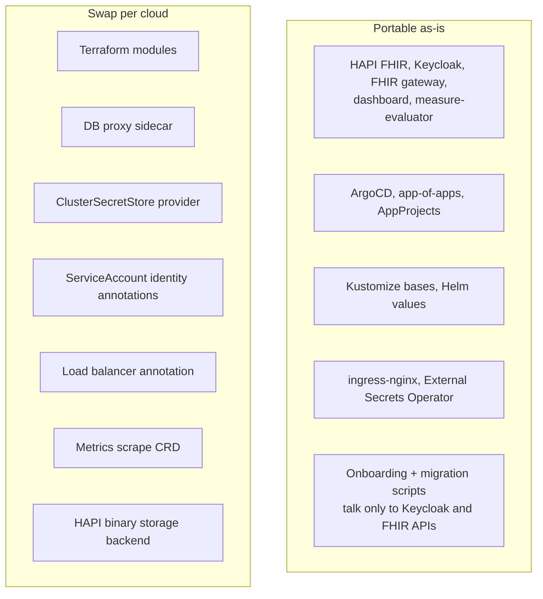

# Running on any cloud

Aarogya Aarohan's application stack is plain Kubernetes plus PostgreSQL plus S3-style object storage. Nothing in the applications requires Google Cloud. The cloud-specific parts are confined to:

1. the Terraform modules under `terraform/modules/`,
2. a handful of Kubernetes objects that integrate with cloud services (DB proxy sidecar, secret store, workload identity annotations, load balancer annotation, metrics scraping), and
3. the object-storage backend configured in HAPI FHIR.

This document maps every cloud service to its equivalents and lists exactly what to change.

---

## 1. Portability by layer

---

## 2. Service mapping

| Capability | GCP (reference) | AWS | Azure | Self-hosted / any Kubernetes |
|---|---|---|---|---|
| Managed Kubernetes | GKE Standard, private cluster | EKS, private endpoint | AKS, private cluster | k3s, RKE2, kubeadm, OpenShift |
| Network | VPC (Shared VPC), VPC-native secondary ranges | VPC, subnets, VPC CNI | VNet, Azure CNI | Your LAN / VLAN |
| Outbound internet | Cloud NAT | NAT Gateway | NAT Gateway | Site firewall / NAT |
| Admin access to private API | Bastion over IAP | Bastion via SSM Session Manager | Azure Bastion | VPN / jump host |
| PostgreSQL | Cloud SQL for PostgreSQL 16, private IP, HA | RDS / Aurora PostgreSQL, Multi-AZ | Azure Database for PostgreSQL Flexible Server, zone-redundant HA | CloudNativePG operator, or Bitnami PostgreSQL chart |
| DB connection | Cloud SQL Auth Proxy sidecar | Direct TLS to RDS endpoint (optionally RDS Proxy / IAM auth) | Direct TLS to server endpoint (optionally Entra auth) | Direct to in-cluster Service |
| Object storage | Cloud Storage bucket per tenant | S3 bucket per tenant | Blob Storage container per tenant | MinIO (S3 API) |
| Secret store | Secret Manager | Secrets Manager or SSM Parameter Store | Key Vault | Vault, or plain Kubernetes Secrets sealed with Sealed Secrets / SOPS |
| Pod → cloud identity | Workload Identity (direct principal or GSA impersonation) | IRSA or EKS Pod Identity | Microsoft Entra Workload ID | Not needed (MinIO/Vault credentials via Secrets) |
| Public load balancer | Regional external Application LB + NEG | AWS Load Balancer Controller (ALB/NLB) | Application Gateway / Azure LB | MetalLB or an upstream reverse proxy |
| TLS certificate | Certificate Manager wildcard on the LB | ACM | Key Vault certificate / App Gateway | cert-manager with Let's Encrypt, or a purchased certificate as a Secret |
| Metrics | Managed Prometheus (`PodMonitoring`) + Cloud Monitoring | Amazon Managed Prometheus + Grafana, or kube-prometheus-stack | Azure Monitor managed Prometheus + Managed Grafana | kube-prometheus-stack (`PodMonitor`/`ServiceMonitor`) + Grafana |
| Alerting / uptime | Cloud Monitoring alert policies, uptime checks | CloudWatch alarms / Alertmanager | Azure Monitor alerts / Alertmanager | Alertmanager, Uptime Kuma, Blackbox exporter |
| Logs | Cloud Logging | CloudWatch Logs | Log Analytics | Loki / OpenSearch |
| Terraform state | GCS backend | S3 backend + DynamoDB lock (or S3 native locking) | `azurerm` backend (Blob) | Any backend; local for a single operator |
| SOPS key | age (today), Cloud KMS (target) | AWS KMS | Azure Key Vault key | age or PGP |
| Container registry | Docker Hub / Artifact Registry | ECR | ACR | Harbor / any OCI registry |

---

## 3. What to change, file by file

### 3.1 Terraform

Keep the stack layout (`_bootstrap`, `network`, `argocd`, `<env>`, `monitoring`) and the module interfaces; replace module internals.

| Module | Inputs it should keep | AWS implementation | Azure implementation |
|---|---|---|---|
| `network` | outputs: network id, subnet id, pod and service ranges | `aws_vpc`/`aws_subnet` data sources or `terraform-aws-modules/vpc` | `azurerm_virtual_network`/`azurerm_subnet` |
| `gke-cluster` → `k8s-cluster` | name, node size, min/max nodes, private endpoint, authorised networks | `terraform-aws-modules/eks` with a managed node group | `azurerm_kubernetes_cluster` with private cluster enabled |
| `cloud-sql` → `postgres` | name, tier/size, HA flag, backup retention, PITR, deletion protection | `aws_db_instance` (Multi-AZ) or `terraform-aws-modules/rds` | `azurerm_postgresql_flexible_server` (HA zone-redundant) |
| `tenant-gcs` → `tenant-bucket` | tenant slug, env prefix, reader and writer identities, CORS origin, lifecycle | `aws_s3_bucket` + versioning + lifecycle + bucket policy for the IRSA roles | storage account container + role assignments for the workload identities |
| `tenant-secrets` | tenant slug, secret names, reader identity | `aws_secretsmanager_secret` + IAM policy for ESO role | `azurerm_key_vault_secret` + access policy / RBAC |
| `argocd`, `argocd-spoke-cred` | unchanged in logic; only the cluster auth provider changes | `aws eks get-token` exec auth | `kubelogin` exec auth |
| `workload-identity-impersonation` | KSA → cloud identity | IAM role with OIDC trust (IRSA) | user-assigned managed identity + federated credential |
| `envs/monitoring` | alerts and dashboards as code | `aws_cloudwatch_metric_alarm`, or PrometheusRule + Grafana dashboards in Git | `azurerm_monitor_*`, or PrometheusRule + Grafana |

The tenant loop (`for_each = toset(var.tenants)`) and the SOPS + `Makefile` wrapper carry over unchanged.

### 3.2 Kubernetes manifests

Create a new overlay per target, e.g. `components/hapi-fhir/overlays/aws-production/`, starting as a copy of the GCP overlay. The differences are confined to these objects:

| Object | GCP | Change for AWS / Azure / self-hosted |
|---|---|---|
| HAPI and Keycloak **DB proxy sidecar** | `cloud-sql-proxy` container, app connects to `127.0.0.1:5432` | Remove the sidecar (a Kustomize `$patch: delete` on the container, or a Helm value for Keycloak) and set the DB host to the RDS / Azure / in-cluster endpoint with `sslmode=require` |
| **ServiceAccount annotations** | `iam.gke.io/gcp-service-account` for the proxy identity | `eks.amazonaws.com/role-arn` (IRSA) or `azure.workload.identity/client-id`; none for self-hosted |
| **ClusterSecretStore** | provider `gcpsm`, project id, workload identity auth | provider `aws` (Secrets Manager, region, IRSA), `azurekv` (vault URL, workload identity), or `vault` / `kubernetes`. The ExternalSecrets themselves do not change, as long as the remote key names exist. |
| **ingress-nginx Service** | NEG annotation `cloud.google.com/neg` | `service.beta.kubernetes.io/aws-load-balancer-type: nlb` (or an ALB Ingress in front), Azure LB annotations, or `type: LoadBalancer` with MetalLB |
| **Metrics scraping** | `PodMonitoring` (`monitoring.googleapis.com/v1`) | `PodMonitor` / `ServiceMonitor` (`monitoring.coreos.com/v1`) with the same port and path |
| **HAPI binary storage** (`patch-configmap.yaml`) | GCS bucket template `<prefix>-{partition}-fhir-media` | S3 / MinIO endpoint, region and bucket template; Azure via an S3-compatible gateway or a storage adapter in the fhir-server fork (see note) |
| **Ingress hostnames** | your domain | your domain |

> **Note on object storage.** The fhir-server fork stores binary content through an object-storage client. Confirm in the fhir-server repository which providers are implemented before targeting Azure Blob directly; MinIO in gateway mode or any S3-compatible endpoint works for AWS and self-hosted targets.

### 3.3 ArgoCD

Only the destination cluster registration changes. The `argocd-spoke-cred` module creates a ServiceAccount and token in each workload cluster, which works on any conformant Kubernetes. AppProjects, root Applications and sync policies are unchanged; point `repoURL` at your fork.

### 3.4 Scripts

`scripts/` talks to Keycloak and the FHIR server over HTTPS, and to the secret store for client secrets. Replace the `gcloud secrets` calls in `scripts/lib/` with `aws secretsmanager`, `az keyvault secret` or `kubectl create secret` as appropriate. Everything else is cloud-neutral.

---

## 4. Worked example: single-server or on-premises deployment

For a programme that cannot use a public cloud (data residency, cost, connectivity), the platform runs on a single VM or a small on-premises cluster. The predecessor `self-hosted/` repository is exactly this pattern and serves as a reference:

| Concern | On-premises choice |
|---|---|
| Kubernetes | k3s (single node or three-node HA with embedded etcd) |
| PostgreSQL | CloudNativePG operator, with scheduled backups to S3-compatible storage |
| Object storage | MinIO |
| Secrets | Sealed Secrets or SOPS-encrypted manifests decrypted by ArgoCD (KSOPS); **not** plain `.env` files in Git |
| TLS | cert-manager with Let's Encrypt where the host is reachable from the internet; otherwise an institutional certificate stored as a Kubernetes Secret created out-of-band |
| Ingress | k3s bundled Traefik or ingress-nginx; site firewall forwards 443 |
| Monitoring | kube-prometheus-stack + Uptime Kuma for external probes |
| Backups of cluster state | Embedded etcd snapshots (HA) or Litestream for single-node SQLite datastore |
| Encryption at rest | Disk encryption (LUKS) on the host and k3s `--secrets-encryption` |

---

## 5. Portability checklist

- [ ] Terraform modules re-implemented for the target cloud with the same inputs and outputs
- [ ] New Kustomize overlays created for each target environment
- [ ] DB proxy sidecar removed; DB host and TLS mode set
- [ ] ServiceAccount identity annotations switched
- [ ] ClusterSecretStore provider switched; remote secret names created
- [ ] Load balancer annotation switched
- [ ] Metrics CRDs switched
- [ ] HAPI binary storage endpoint switched and tested with an image upload
- [ ] `repoURL` points at your fork
- [ ] End-to-end verification from [deployment-guide.md § Verify](deployment-guide.md#5-verify) passes
