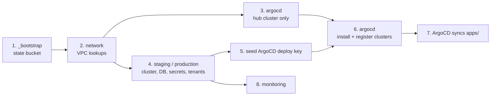

# Deployment guide

This guide stands up the full Aarogya Aarohan platform in an empty cloud account, using the Google Cloud reference implementation in this repository. For AWS, Azure or self-managed Kubernetes, read this guide for the order of operations and [cloud-portability.md](cloud-portability.md) for what to substitute.

Expected outcome: a staging environment (and optionally production) serving the FHIR API, Keycloak and the web dashboard on your own domain, with ArgoCD keeping the clusters in sync with your fork.

---

## 1. Before you start

### Accounts and permissions

| You need | Why |
|---|---|
| A cloud project/account where you can create Kubernetes clusters, a managed PostgreSQL instance, buckets, secret entries and IAM bindings | All Terraform stacks |
| A VPC with one subnet and two secondary ranges (pods, services), or permission to create one | The `network` stack looks these up. In the reference deployment a central platform team owns the VPC (Shared VPC); if you own your own network, you can replace the lookups with resources. |
| Private services access (VPC peering for managed PostgreSQL) on that VPC | Database private IP |
| A NAT gateway on the subnet | Outbound internet for private nodes (image pulls, external APIs) |
| A DNS name you control, and a TLS certificate for it | Public endpoint |
| An external HTTPS load balancer able to target the ingress-nginx network endpoint group | Public traffic into the cluster |
| A bastion VM inside the VPC, reachable through an identity-aware tunnel | The clusters' API endpoints are private |
| A Git host where ArgoCD can read your fork (an SSH deploy key) | GitOps |

### Tools

`terraform` ≥ 1.5, `kubectl`, `helm` 3, `kustomize` 5, `sops` ≥ 3.8, `age` ≥ 1.1, `jq`, `make`, `gcloud`. Install them on your workstation **and** on the bastion: anything that talks to a cluster API (the `argocd` stack, `kubectl`, onboarding scripts) must run from the bastion.

---

## Values you must set

Every deployment-specific value is an input. These are the only places to change:

| Where | What |
|---|---|
| `terraform/backend.hcl` | Name of your Terraform state bucket |
| `terraform/envs/<stack>/secrets.enc.json` | `project_id`, `region`, `master_ipv4_cidr`, `master_authorized_networks`, `enable_private_endpoint`, `tenants` (see [`terraform/secrets.example.json`](../terraform/secrets.example.json)) |
| `.sops.yaml` | Public keys allowed to decrypt the files above |
| `apps/**/*.yaml`, `projects/*.yaml` | `repoURL` of **your** fork |
| `components/*/overlays/<env>/kustomization.yaml` | Public hostname per environment (ingress patch), image tags |
| `components/keycloak/values-<env>.yaml` | Keycloak hostname |
| `components/external-secrets/` | Cloud project of the secret store; secret entry names if you rename them |
| `components/hapi-fhir/overlays/<env>/patch-configmap.yaml` | Bucket name template for tenant media |
| Environment variables from [`scripts/.env.example`](../scripts/.env.example) | Base URLs and project for the scripts |

A quick way to find anything you missed:

```bash
grep -rn --include='*.yaml' --include='*.tf' --include='*.hcl' -e 'repoURL' -e 'host:' -e 'project' . | grep -v '^./docs'
```

---

## 2. Prepare the repository

```bash
git clone https://github.com/<your-org>/aarogya-aarohan-dpg-infra.git
cd aarogya-aarohan-dpg-infra/managed-cloud

# 2.1 Create an age key for SOPS (keep the private key safe; back it up)
mkdir -p ~/.config/sops/age
age-keygen -o ~/.config/sops/age/keys.txt
grep 'public key' ~/.config/sops/age/keys.txt

# 2.2 Replace the recipients in .sops.yaml with your public key(s)

# 2.3 Create an encrypted variables file per stack from the example
for s in network argocd staging production monitoring; do
  cp terraform/secrets.example.json terraform/envs/$s/secrets.enc.json
  "${EDITOR:-vi}" terraform/envs/$s/secrets.enc.json      # set your values
  sops --encrypt --in-place terraform/envs/$s/secrets.enc.json
done

# 2.4 Install the pre-commit hook that blocks committing decrypted files
pre-commit install
```

Never run a bare `terraform plan`. The `Makefile` wraps every command in `sops exec-file` so decrypted values only exist in a temporary file during the run, and `make apply` applies only the plan file produced by `make plan`.

---

## 3. Apply the stacks in order

Each directory in `terraform/envs/` is an independent Terraform root with its own state prefix in the remote-state bucket. Order matters because later stacks read earlier stacks' outputs through `terraform_remote_state`.



### Step 1: remote state

```bash
make apply ENV=_bootstrap
```
Creates the bucket that stores every other stack's state. This stack uses local state because the bucket does not exist yet; keep its state file safe or import the bucket later.

### Step 2: network

```bash
make plan ENV=network && make apply ENV=network
```
In the reference deployment the network is owned by a central platform team (Shared VPC), so this stack only looks up the VPC, subnet and secondary ranges and exposes them as outputs. If you own your network, `terraform/modules/network` can also create the VPC, subnet with `pods` and `services` secondary ranges, Cloud NAT and the IAP and internal firewall rules.

### Step 3: hub cluster

Stacks that only use the cloud provider (`_bootstrap`, `network`, `staging`, `production`, `monitoring`) can run from a workstation. The `argocd` stack uses the Kubernetes provider against all three private control planes, so run it from the bastion.

Create only the hub cluster first, because ArgoCD needs the workload clusters to exist before it can register them:

```bash
cd terraform/envs/argocd
sops exec-file --filename secrets.tfvars.json secrets.enc.json \
  'terraform init -backend-config=../../backend.hcl -backend-config="prefix=argocd" && \
   terraform apply -var-file={} -target=module.cluster'
cd -
```

### Step 4: workload environments

```bash
make plan ENV=staging && make apply ENV=staging
# optional, same code with production values:
make plan ENV=production && make apply ENV=production
```

Each environment stack creates:
- a private Kubernetes cluster with one autoscaling node pool and workload identity;
- a managed PostgreSQL 16 instance (private IP, TLS required, backups, PITR; HA and deletion protection in production) with its admin, HAPI and Keycloak users and generated passwords;
- shared secret entries (database credentials, Keycloak admin, tenant credential bundle, dashboard tenant map, notification bot token) with read access for the External Secrets Operator identity;
- for each slug in `tenants`: a media bucket (`<env-prefix>-<tenant>-fhir-media`) with access for HAPI and the gateway, and the tenant's secret entries;
- the database proxy identity bindings.

### Step 5: seed the ArgoCD deploy key

Terraform generates the database passwords (admin, HAPI and Keycloak users) and the Keycloak admin password with `random_password` and stores them in the secret store, so no database credential is ever typed by hand. The one secret you add yourself is the SSH key ArgoCD uses to read your fork. Do this before step 6:

```bash
ssh-keygen -t ed25519 -C argocd -f /tmp/argocd_repo -N ""
gcloud secrets create <prefix>-argocd-repo-sshkey --replication-policy=automatic --project <project-id>
gcloud secrets versions add <prefix>-argocd-repo-sshkey --data-file=/tmp/argocd_repo --project <project-id>
# add /tmp/argocd_repo.pub as a read-only deploy key on your fork, then:
shred -u /tmp/argocd_repo /tmp/argocd_repo.pub
```

Per-tenant secrets (gateway environment, Keycloak client secret) are created with placeholder values and filled in during [tenant onboarding](tenant-onboarding.md). To rotate a generated password, `terraform taint` its `random_password` resource and re-apply.

### Step 6: install ArgoCD

From the **bastion** (the hub cluster API is private):

```bash
make plan ENV=argocd && make apply ENV=argocd
```

This:
1. installs ArgoCD on the hub cluster with Helm;
2. creates the repository credential from the deploy key in the secret store;
3. creates an `argocd-manager` ServiceAccount in each workload cluster and registers the cluster in ArgoCD as `staging` / `production`;
4. creates the two root Applications, `app-of-apps` and `app-of-projects`.

After this step Terraform never touches Kubernetes objects again.

### Step 7: let ArgoCD sync

ArgoCD renders `apps/` and deploys, in sync-wave order: External Secrets Operator and its CRDs, then ingress-nginx and the secret stores, then HAPI FHIR, Keycloak, the FHIR gateway, the dashboard and the measure-evaluator.

```bash
kubectl --context <hub> -n argocd get applications
# all should reach Synced / Healthy
```

### Step 8: monitoring

```bash
make plan ENV=monitoring && make apply ENV=monitoring
```
Creates dashboards, alert policies for each environment, uptime checks and notification channels. Alert policies can be shipped disabled (`alerts_enabled = false`) until thresholds are tuned for your traffic.

### Step 9: public endpoint

Point your load balancer's backend service at the network endpoint group that ingress-nginx created (its name comes from the annotation in `components/ingress-nginx` values), attach your TLS certificate, and create a DNS record for your hostname.

---

## 4. Seed the platform and add the first tenant

1. Once HAPI is `Ready`, seed the shared `DEFAULT` partition (once per environment):
   ```bash
   export STAGING_BASE_URL=https://<your-hostname>   # or PRODUCTION_BASE_URL
   export GCP_PROJECT_ID=<project-id>
   scripts/seed-fhir-bundle.sh --env staging
   ```
   This creates a `fhir-bootstrap` service client in Keycloak's `master` realm and posts `scripts/assets/fhir/bundle.<env>.json` (SearchParameter, CodeSystem, StructureMap, Library, Questionnaire, PlanDefinition, Composition, Location, Binary) as a transaction to `/fhir/DEFAULT`. It is idempotent; `--force` re-pushes.
2. Follow [tenant-onboarding.md](tenant-onboarding.md) for your first tenant.

---

## 5. Verify

```bash
BASE=https://<your-hostname>

curl -s $BASE/fhir/metadata | jq '.fhirVersion'                 # "4.0.1"
curl -s $BASE/auth/realms/<tenant>/.well-known/openid-configuration | jq .issuer
TOKEN=$(scripts/get-jwt.sh --env staging --tenant <tenant> --user <user> --password <password>)
curl -s -H "Authorization: Bearer $TOKEN" "$BASE/fhir/<tenant>/Patient?_count=0" | jq .total
# a request for another tenant with this token must return 403
```

Open `$BASE/dashboard`, choose the tenant and log in with a user from its realm.

---

## 6. Tearing down

Destroy in reverse order: `monitoring`, `argocd`, `production`, `staging`, `network`, `_bootstrap`. Production PostgreSQL has deletion protection enabled; disable it deliberately first. Buckets with data must be emptied before Terraform can delete them.
