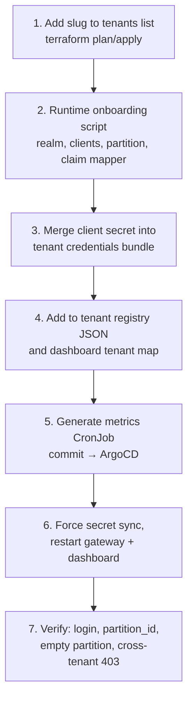

# Tenant onboarding

A **tenant** is one screening programme (a state, district or hospital). Adding a tenant creates no new clusters or databases: it adds a bucket and secret entries (Terraform), then a Keycloak realm and FHIR partition (script), then registers the tenant with the services that read the tenant list.

Allow about 1.5 hours the first time. Run every step that calls a cluster or in-cluster service from the bastion (or from your laptop for a local cluster).

---

## Overview



**Why so many places?** Different consumers keep their own view of "which tenants exist": Terraform (cloud resources), Keycloak and HAPI (runtime objects), the secret store (credentials), the registry JSON (gateway, dashboard and Android app) and the metrics CronJobs. Missing any one of them produces a tenant that half-works, often without an error. Follow every step.

### Preconditions

- The `DEFAULT` partition is seeded with shared reference data and CQL libraries (once per environment).
- The tenant slug is lowercase, URL-safe, and not used in any other environment.

---

## Step 1: cloud resources

```bash
sops terraform/envs/<env>/secrets.enc.json     # append "<tenant>" to .tenants
make plan ENV=<env>
```

The plan must show only `module.tenant_gcs["<tenant>"]` (bucket plus access bindings for HAPI and the gateway) and `module.tenant_secrets["<tenant>"]` (the tenant's secret entries, such as `<prefix>-<tenant>-fhir-gateway-env` and `<prefix>-<tenant>-keycloak-client-secret`, created with placeholder values, plus External Secrets read access). If anything else changes, stop and investigate.

```bash
make apply ENV=<env>
```

## Step 2: runtime onboarding

```bash
export PRODUCTION_BASE_URL=https://<your-hostname>   # or STAGING_BASE_URL
export GCP_PROJECT_ID=<project-id>
scripts/onboard-tenant-runtime.sh --env <env> --tenant <tenant>   # --base-url overrides the variable
```

The script is idempotent. It:
- creates the `<tenant>` realm in Keycloak;
- creates the dashboard login client, an `api-client` service client and a `support` client with the required FHIR roles;
- adds the `partition_id` claim mapper to the login clients;
- creates the `<tenant>` partition in HAPI FHIR;
- seeds the tenant's `Measure` resource and feature flags;
- writes the generated `api-client` secret to the tenant's secret entry.

New Keycloak realms allow only `localhost` redirect URIs by default. Set the dashboard client's redirect URIs and web origins to your public hostname.

## Step 3: credentials bundle

The gateway reads one consolidated JSON secret keyed by tenant slug, not individual per-tenant secrets. Merge the new client secret into it:

```json
{
  "<tenant>": {
    "fhir_client": { "id": "api-client", "secret": "<value from step 2>" }
  }
}
```

Add it as a new version of the `<prefix>-arogyam-tenant-credentials` secret (e.g. `aa-prod-arogyam-tenant-credentials`). If this step is skipped the gateway sends unauthenticated requests for this tenant without logging an error.

## Step 4: registries

1. Add an entry for the tenant to the tenant registry JSON in object storage (code, display name, FHIR base URL, realm).
2. Add the tenant's realm and client to the dashboard tenant map secret (`KEYCLOAK_TENANTS_JSON`).

## Step 5: metrics job

```bash
scripts/gen-evaluator-cronjobs.sh --env <env>   # options: --stagger, --start-hour, --deadline, --suspend
git add components/measure-evaluator/overlays/<env>/cronjobs-generated.yaml
git commit -m "measure-evaluator: add <tenant>"
```

Open a pull request; after merge ArgoCD creates the CronJob.

## Step 6: propagate

The gateway (`web` and `cron`) and dashboard read tenant configuration only at start-up.

```bash
# force an immediate ExternalSecret refresh instead of waiting up to an hour
kubectl -n arogyam annotate externalsecret --all force-sync=$(date +%s) --overwrite
kubectl -n arogyam rollout restart deploy/fhir-gateway deploy/fhir-gateway-cron deploy/arogyam-dashboard
```

## Step 7: verify

| Check | Proves |
|---|---|
| `GET /auth/realms/<tenant>/.well-known/openid-configuration` returns 200 | Realm exists |
| A user token, decoded, contains `partition_id: <tenant>` | Claim mapper is attached |
| `GET /fhir/<tenant>/Patient?_count=0` returns `total: 0` | Partition exists and is empty |
| The same token against `/fhir/<other-tenant>/Patient` returns 403 | Isolation is enforced |
| Dashboard login for the tenant lands in the right realm | Dashboard picked up the tenant map |

Commit the Terraform variables change (step 1) with a message naming the tenant, so the onboarding has an auditable record.

---

## Offboarding a tenant

1. Export the tenant's data: FHIR `$export` for the partition, Keycloak realm export, and a copy of the bucket.
2. Remove the tenant from the registry JSON and dashboard tenant map; restart the gateway and dashboard.
3. Remove its metrics CronJob (regenerate and commit).
4. Delete the realm and the partition.
5. Remove the slug from `tenants` and apply; empty the bucket first if Terraform must delete it.

Follow the programme's data-retention agreement before deleting anything.
