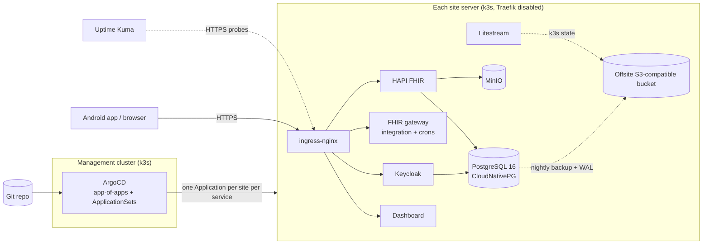

# Self-hosted deployment (one stack per site)

This folder is the GitOps configuration for running **Aarogya Aarohan** as a **self-hosted, single-tenant stack per site** on lightweight Kubernetes (k3s), on ordinary virtual machines or on-premises servers.

This is the deployment model for programmes that need everything on their own hardware, or that cannot depend on a public cloud. Each site gets its own complete stack: FHIR server, FHIR gateway, identity provider, database, object storage and web dashboard. A management cluster running ArgoCD keeps every site in sync with this repository using ApplicationSets.

For the multi-tenant managed-cloud deployment, see [`../managed-cloud/`](../managed-cloud/README.md). Both deploy the same application images.

> **Clinical disclaimer.** Aarogya Aarohan is an **assisted screening tool**. It is **not an autonomous diagnostic device**; clinical decisions remain with qualified professionals.

---

## When to use this model

| Choose this (self-hosted, per site) when | Choose managed-cloud (multi-tenant) when |
|---|---|
| Data must stay on the programme's own servers | A cloud region satisfies data-residency rules |
| There is no cloud account or budget for managed services | You want the provider to run databases, backups and control planes |
| A small number of sites, each operated locally | Many tenants, onboarded without new infrastructure |
| Connectivity to a central cloud is unreliable | One upgrade for all tenants and central monitoring matter most |

---

## Architecture



| Component | How it is deployed here |
|---|---|
| k3s | Installed by `script/k3s/cluster-init.sh`; bound to the server's private IP, Traefik disabled |
| Cluster-state backup | Litestream replicates the k3s SQLite datastore to S3 and restores it on reinstall |
| ArgoCD | App-of-apps (`apps/app_of_apps`) plus AppProjects (`projects/`); each Arogyam service is an ApplicationSet with one list element per site |
| ingress-nginx | Helm chart 4.8.3 (`apps/ingress-nginx`) |
| cert-manager | Helm chart v1.15.2 with a Let's Encrypt `ClusterIssuer` (`components/certificates_issuer`); sites behind an institutional edge use a purchased certificate stored as a TLS Secret instead |
| PostgreSQL | CloudNativePG operator (chart 0.21.5); a `Cluster` per site with PostgreSQL 16, barman backups to S3 (gzip, AES256, 7-day retention) and a nightly `ScheduledBackup` |
| Object storage | MinIO (Bitnami chart 14.6.11, `bitnamilegacy` images; see Known limitations) |
| HAPI FHIR + FHIR gateway | `components/arogyam/fhir` (the gateway is the `fhir-integration` Deployment) |
| Keycloak | `components/arogyam/auth` |
| Dashboard | `components/arogyam/dashboard` |
| Monitoring | Uptime Kuma (`apps/uptime`) probing public endpoints |

---

## Folder layout

```
apps/
├── app_of_apps/          root Application: deploys everything under self-hosted/apps/
├── app_of_projects/      AppProjects
├── arogyam/              ApplicationSets: fhir.yaml, auth.yaml, dashboard.yaml
├── cnpg/  minio/  cert-manager/  ingress-nginx/  uptime/
components/
├── arogyam/
│   ├── fhir/
│   │   ├── base/                              HAPI, gateway, CNPG Cluster, ingresses
│   │   └── environment/example-site/resources/ kustomization, patches, .env-*.example
│   ├── auth/      (same shape, plus environment/example-site/values/ for the Keycloak chart)
│   └── dashboard/ (same shape)
└── certificates_issuer/  Let's Encrypt ClusterIssuer
projects/            ArgoCD AppProjects (management, arogyam-production)
script/k3s/          cluster-init.sh, management-init.sh
values/              shared Helm values (MinIO, Uptime Kuma)
docs/                deployment guide
```
Each site overlay (`environment/<site>/resources/kustomization.yaml`) takes `../../../base`, patches the ingress hostnames and database settings, pins image tags with `images:`, and builds Secrets with `secretGenerator` from per-site env files.

---

## Quick start

Full steps are in [docs/deployment-guide.md](docs/deployment-guide.md). In short:

1. Provision one Linux server per site and one for management.
2. Run `script/k3s/cluster-init.sh` on each (installs Litestream and k3s).
3. Install ArgoCD on the management server, register each site cluster, and point ArgoCD at your fork.
4. Create the site's env files: copy each `.env-*.example` in the overlays to `.env-*.secret` and fill it in. `*.secret` is git-ignored.
5. Copy `environment/example-site/` for each real site and add the site to the ApplicationSets in `apps/`.
6. Merge; ArgoCD deploys the stack.

### Prerequisites

| Tool | Used for |
|---|---|
| A Linux server per site (Ubuntu LTS or similar) with root access | k3s |
| kubectl, kustomize, helm, argocd CLI | Rendering manifests, registering clusters |
| An S3-compatible bucket | Litestream and PostgreSQL backups |
| A DNS name and TLS certificate per site (or cert-manager with Let's Encrypt) | HTTPS |

---

## Known limitations

- The MinIO and Keycloak charts come from Bitnami. Bitnami moved its free images to `bitnamilegacy`, which no longer receives security updates, and MinIO community edition is in maintenance mode. Plan to move to maintained images (for example the official Keycloak operator and another S3-compatible store) before a new production rollout.
- The example site gets TLS from Secrets named `arogyam-fhir-integration-tls`, `arogyam-dashboard-tls` and `arogyam-auth-tls`. Create them yourself, or add cert-manager annotations to the ingresses to have them issued.
- MinIO reads its root credentials from a Secret named `minio-root-credentials` (keys `root-user`, `root-password`) in the `minio` namespace, which you create.

## License

Licensed under the [Apache License 2.0](../LICENSE).
